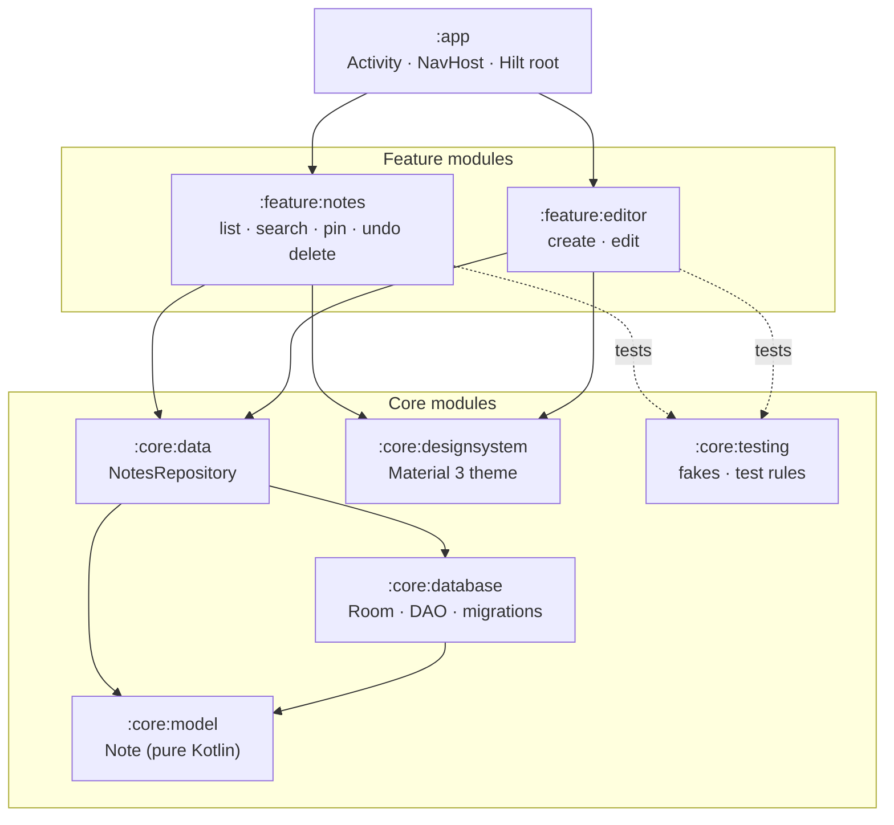
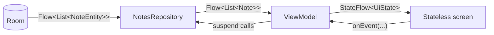

# compose-notes-offline

[](https://github.com/mhxtecnologia/compose-notes-offline/actions/workflows/ci.yml)


[](LICENSE)

An offline-first Android notes app built with Jetpack Compose. Small on purpose, so the
interesting parts are easy to find:

- **Unidirectional data flow** — every screen is a stateless composable that takes an
  immutable `UiState` and emits events; the ViewModel is the only place that changes state.
- **Data you can trust** — Room is the single source of truth, schemas are versioned in
  git, and the v1 → v2 migration is tested on an emulator in CI to prove that no note is
  lost. There is no `fallbackToDestructiveMigration` anywhere.
- **A modular build that scales** — feature and core modules wired by convention plugins
  and a version catalog, following the [Now in Android](https://github.com/android/nowinandroid)
  architecture at a smaller scale.

Features: create, edit, search, pin and delete notes (with undo), light and dark themes,
dynamic color on Android 12+, English and Brazilian Portuguese.

## Architecture



Features never depend on each other: `:app` is the only module that knows both and wires
the navigation between them. `:core:model` is a plain Kotlin module, so the domain type
has no Android dependency.

Inside each feature, data flows in one direction:



## Technical decisions

| Decision | Why |
|---|---|
| Stateless screens (`NotesListScreen(uiState, onEvent)`) behind a thin `Route` | The screen can be previewed and UI-tested without Hilt or a ViewModel. |
| `StateFlow` + `stateIn(WhileSubscribed(5_000))`, collected with `collectAsStateWithLifecycle` | Work stops when the app goes to the background, but survives a rotation without re-querying. |
| Search with `flatMapLatest` | Each keystroke cancels the previous query and observes only the new one. |
| Undo is **state** (`recentlyDeleted`), not a one-off event | Follows Android's UI-layer guidance: nothing is lost on rotation and the snackbar result goes back as an event. |
| Editor text lives in a `MutableStateFlow` updated synchronously | Text fields read their value without async hops, so the cursor never jumps while typing. |
| LIKE wildcards are escaped (`ESCAPE '\'`) | Searching for `50%` finds "50%", not "500". |
| `java.time.Clock` injected into the repository | Tests control timestamps without sleeping or mocking statics. |
| Fakes instead of mocks | Tests check behavior (what the user sees) rather than which methods were called. |
| Hilt and Room processed by KSP | Faster builds than kapt. |
| Debug build uses `applicationIdSuffix = ".debug"` | Development and instrumented tests never touch the production package or its data. |

## Database and migrations

The schema of every version is exported by Room to
[`core/database/schemas`](core/database/schemas) and committed. CI fails if a build
produces a schema that is not in git, so a version bump can't ship without its schema.

| Version | Change | Migration |
|---|---|---|
| 1 | `notes` table: title, content, created/updated timestamps | — |
| 2 | Pinned notes: `is_pinned INTEGER NOT NULL DEFAULT 0` + index on `(is_pinned, updated_at)` | [`Migration1To2`](core/database/src/main/kotlin/com/mhxtecnologia/notes/core/database/Migration1To2.kt) |

[`MigrationTest`](core/database/src/androidTest/kotlin/com/mhxtecnologia/notes/core/database/MigrationTest.kt)
uses `MigrationTestHelper` to create a real v1 database from `1.json`, insert notes with
raw SQL, run the migration and validate the result against `2.json`. A second test opens
the migrated file with the actual Room database, which checks the schema against the
compiled entities and reads the old notes back through the DAO.

## Accessibility

- Every icon button has a `contentDescription` that names the note it acts on
  ("Delete note: Groceries"); decorative icons use `null`.
- Touch targets are at least 48 dp (Material icon buttons).
- The pin button is a real toggle: TalkBack announces "on/off" instead of changing its label.
- Each note card is one focusable block with a custom click label ("Open note"), while
  pin and delete remain separate actions.
- Screen titles are marked as headings; loading indicators are announced.

## Testing

| Layer | Tooling | Where |
|---|---|---|
| Repository | JUnit, Turbine, coroutines-test, fake DAO | `core/data/src/test` |
| ViewModels | JUnit, Turbine, coroutines-test, `FakeNotesRepository`, `MainDispatcherRule` | `feature/*/src/test` |
| DAO queries | Room in-memory database, on an emulator | `core/database/src/androidTest` |
| Migration v1 → v2 | `MigrationTestHelper`, on an emulator | `core/database/src/androidTest` |
| Compose UI | `createComposeRule`, semantics matchers | `feature/*/src/androidTest` |

The UI tests find elements the way a screen reader does (by content description, toggle
state and text), so they double as accessibility checks.

## Continuous integration

[`.github/workflows/ci.yml`](.github/workflows/ci.yml) runs two jobs on every push:

1. **Build** — detekt, Android Lint, unit tests, debug APK (uploaded as the
   `compose-notes-debug-apk` artifact) and the Room schema check.
2. **Instrumented** — boots an API 30 emulator with
   [android-emulator-runner](https://github.com/ReactiveCircus/android-emulator-runner)
   and runs `connectedDebugAndroidTest` (Compose UI, DAO and migration tests).

## Running it

Requirements: JDK 17 and the Android SDK (Android Studio Ladybug or newer).

```bash
./gradlew installDebug              # build and install on a connected device or emulator
```

Or download the debug APK from the latest successful
[CI run](https://github.com/mhxtecnologia/compose-notes-offline/actions/workflows/ci.yml).

Other useful tasks:

```bash
./gradlew testDebugUnitTest         # unit tests
./gradlew connectedDebugAndroidTest # UI, DAO and migration tests (needs a device)
./gradlew detekt lintDebug          # static analysis
```

## Project layout

```
app/                 Activity, navigation graph, Hilt application
build-logic/         Convention plugins (application, library, feature, compose, hilt, room)
core/model/          Note (pure Kotlin)
core/database/       Room entity, DAO, database, migrations, exported schemas
core/data/           Offline-first repository
core/designsystem/   Material 3 theme with dynamic color
core/testing/        Shared fakes and JUnit rules
feature/notes/       Notes list
feature/editor/      Note editor
gradle/libs.versions.toml   Version catalog
```

## License

[MIT](LICENSE) © Matheus Henrique Takeuchi
